# Análise estatística do modelo atual

O modelo detecta **61,1% dos desastres** municipais e reconhece **78,7% dos dias sem desastre** no período de teste (2021–2024), com AUC de 0,747. No nível de risco mais alto, a chance real de desastre é **5,6 vezes a média**.

**Origem dos números:**
- desempenho e previsões: execução do modelo de 06/11/2026 (arquivo `analises_anteriores/analise_2026-11-06_15-44-54.txt`);
- análises de limiares, importância das variáveis e climatologia: refeitas em 20/11/2026 com a mesma configuração (`limiares_2026-11-20_12-22-54.txt`, `importancia_2026-11-20_12-23-27.txt` e `climatologia_2026-11-20_12-23-44.txt`).

**Configuração:** 293 municípios, dados diários de 02/06/2000 a 31/12/2024 (2.630.847 linhas). Evento = registro de desastre nos 3 dias seguintes. Treino até 31/12/2016, validação de 2017 a 2020 e teste de 2021 a 2024. Janela de 30 dias, arquitetura com ramo de contexto, focal loss, limiar adaptativo pelo critério de equilíbrio.

| Período | Amostras (município-dias) | Com evento | Taxa |
| --- | --- | --- | --- |
| Treino (amostrado) | 449.624 | 10.765 | — |
| Validação | 428.073 | 4.657 | 1,09% |
| Teste | 427.194 | 14.147 | 3,31% |

A taxa de eventos no teste é 3 vezes a da validação: os registros de desastre ficaram muito mais frequentes a partir de 2021.

## 1. Desempenho das previsões

| Nível | Sensibilidade | Especificidade | Acurácia | Acurácia balanceada | Precisão | AUC-ROC |
| --- | --- | --- | --- | --- | --- | --- |
| Municipal | 61,1% | 78,7% | 78,2% | 69,9% | 9,0% | 0,747 |
| Estadual (10+ municípios) | 57,8% | 57,7% | 57,8% | 57,8% | 40,9% | 0,596 |

A meta de pelo menos 50% de acerto em cada classe foi atingida nos dois níveis. A precisão municipal é baixa (9%) porque o evento é raro: alertas ao acaso acertariam 3,3%.

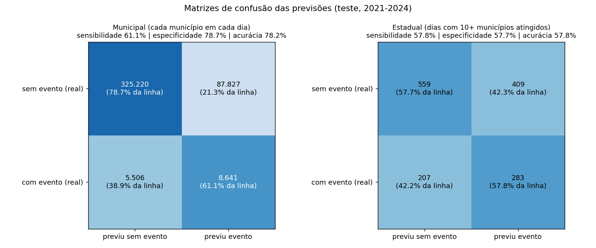

O modelo e a climatologia (probabilidade histórica de desastre do município no mês) têm curvas quase iguais. O ponto vermelho é o alerta atual.

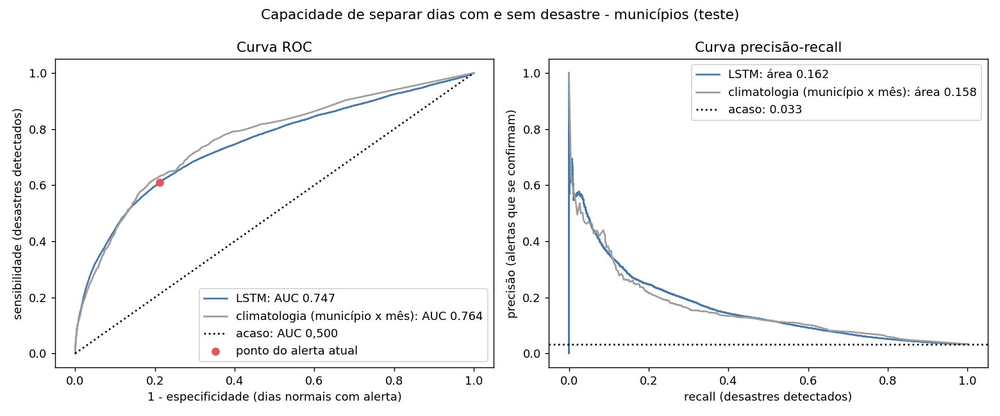

| Modelo | AUC-ROC | PR-AUC (acaso 0,033) |
| --- | --- | --- |
| LSTM | 0,747 | 0,162 |
| Climatologia (município × mês) | 0,764 | 0,158 |

## 2. Níveis de risco e comunicados

| Nível | Comunicado | Parte dos dias | Chance real de desastre | Comparação com a média | Parte dos desastres |
| --- | --- | --- | --- | --- | --- |
| Baixo | Observação | 50,0% | 1,3% | 0,4× | 19,8% |
| Médio | Aviso | 29,8% | 2,4% | 0,7× | 21,7% |
| Alto | Alerta | 15,1% | 6,4% | 1,9× | 29,0% |
| Muito alto | Alerta | 5,2% | 18,7% | 5,6× | 29,5% |

Os níveis alto e muito alto (comunicado de alerta) são 20% dos dias e concentram 58,5% dos desastres.

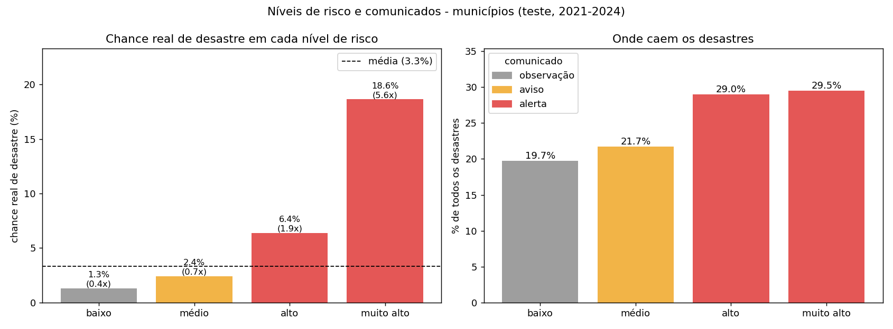

No nível estadual, os níveis separam pouco: a chance de evento vai de 26,8% (baixo) a 45,9% (muito alto).

## 3. Desempenho por município

| Município | Eventos | Alertas | Detectados | Sensibilidade | Precisão | AUC |
| --- | --- | --- | --- | --- | --- | --- |
| Florianópolis | 797 | 1.458 | 797 | 100% | 54,7% | 0,628 |
| Joinville | 539 | 1.458 | 539 | 100% | 37,0% | 0,680 |
| Içara | 475 | 947 | 331 | 69,7% | 35,0% | 0,605 |
| Blumenau | 459 | 1.458 | 459 | 100% | 31,5% | 0,642 |
| Camboriú | 323 | 1.346 | 309 | 95,7% | 23,0% | 0,611 |
| Balneário Camboriú | 311 | 1.353 | 298 | 95,8% | 22,0% | 0,562 |
| Ermo | 272 | 93 | 17 | 6,2% | 18,3% | 0,600 |
| Rio do Sul | 234 | 1.158 | 192 | 82,1% | 16,6% | 0,569 |
| Taió | 221 | 745 | 153 | 69,2% | 20,5% | 0,679 |
| Chapecó | 220 | 1.458 | 220 | 100% | 15,1% | 0,549 |

**Limitação do limiar único:** com um limiar comum a todos os municípios, os que registram muitos desastres (Florianópolis, Joinville, Blumenau, Chapecó) ficam em alerta em todos os 1.458 dias do teste, e os que registram poucos (Ermo) quase nunca. O alerta acerta no agregado, mas, para esses municípios, ele não distingue um dia do outro.

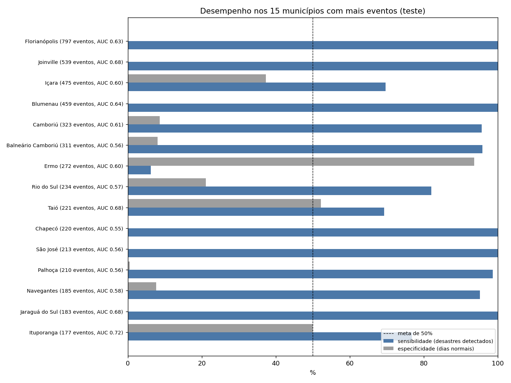

## 4. Alertas ao longo do tempo

O modelo prevê, em média, 3,4 municípios atingidos por dia, contra 9,7 na realidade: ele subestima a escala dos eventos no período de teste.

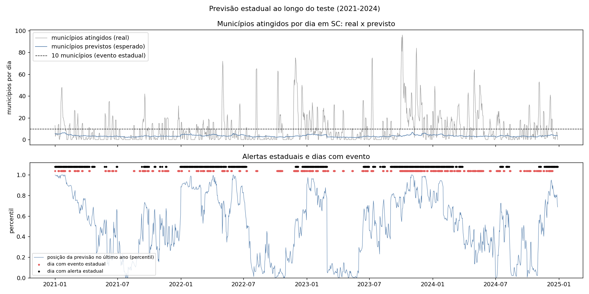

A detecção fica perto ou acima de 50% em todos os meses (mínimo de cerca de 49% em maio e agosto), com os melhores valores de janeiro a março (até 81% em fevereiro). Outubro e novembro tiveram a maior frequência de desastres do teste (5,9% e 5,8% dos município-dias), período que inclui o El Niño forte de 2023.

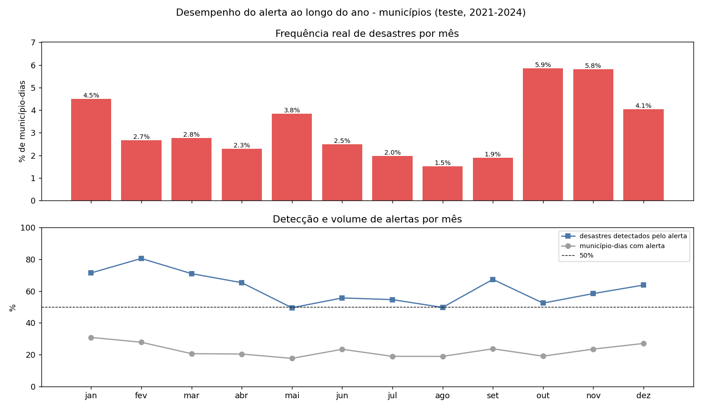

Curvas de treinamento (perda e PR-AUC por época) e curva precisão-recall:

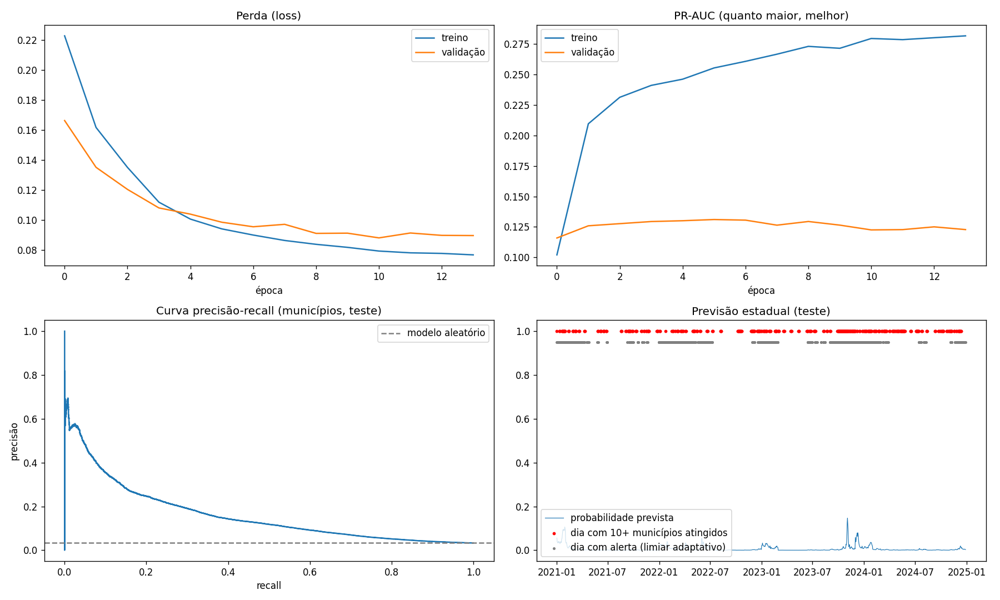

## 5. Variáveis mais associadas aos desastres

Regressão logística multivariada no período de treino, controlando a taxa histórica do município e a época do ano. Variáveis padronizadas (efeito por 1 desvio padrão).

| Variável | Odds ratio | LR χ² | p | Participação |
| --- | --- | --- | --- | --- |
| Chuva acumulada em 30 dias | 1,30 | 268 | 3 × 10⁻⁶⁰ | 37,5% |
| Radiação solar | 0,83 | 196 | 2 × 10⁻⁴⁴ | 27,5% |
| Vento máximo | 1,08 | 75 | 4 × 10⁻¹⁸ | 10,5% |
| Chuva do dia | 1,13 | 75 | 5 × 10⁻¹⁸ | 10,5% |
| Dias de chuva forte em 15 dias | 1,10 | 46 | 1 × 10⁻¹¹ | 6,5% |
| Demais (dias de chuva, acumuladas de 3 e 7 dias) | 0,95 a 1,09 | 5 a 21 | 0,02 a 5 × 10⁻⁶ | menos de 3% cada |

A chuva acumulada em 30 dias (solo saturado) é a variável mais importante. A radiação tem efeito inverso: menos sol indica céu encoberto e chuva persistente. O controle do município tem odds ratio de 8,6, muito acima de qualquer variável meteorológica. As variáveis meteorológicas juntas acrescentam informação significativa além dos controles (LR χ² = 1.957, gl = 9, p < 0,001).

## 6. Limiares de chuva

Menor valor a partir do qual a taxa de desastre fica 2 vezes acima da média (calculado no treino, conferido no teste):

| Variável | Limiar | Desastres acima (treino) | Risco acima vs abaixo (teste) |
| --- | --- | --- | --- |
| Chuva acumulada em 30 dias | 213 mm | 28,8% | 1,9× |
| Dias de chuva em 15 dias | 9 dias | 23,0% | 1,7× |
| Dias de chuva em 7 dias | 6 dias | 10,4% | 2,1× |
| Chuva acumulada em 3 dias | 46 mm | 14,1% | 3,0× |
| Chuva do dia | 22 mm | 12,5% | 2,9× |
| Chuva acumulada em 7 dias | 80 mm | 16,1% | 2,6× |

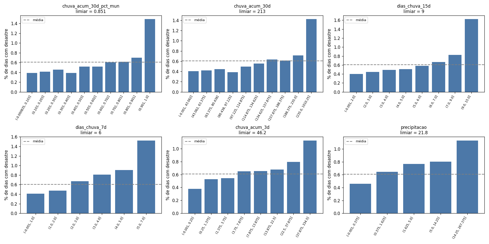

A combinação de maior risco encontrada pela árvore de decisão foi: chuva de 30 dias acima do percentil 93% do município **e** mais de 10 dias de chuva em 15 dias **e** radiação até 6,5 kWh/m². Ela teve 4,4% de desastres no treino (7 vezes a média) e 8,7% no teste.

**Achado central:** 59,4% dos desastres do treino ocorreram com chuva igual à de dias normais (mediana de 107 mm em 30 dias, contra 115 mm nos dias sem desastre). Esses registros não podem ser previstos por variáveis de chuva. Municípios do Oeste, como Chapecó (72% dos desastres fora dos limiares), sugerem estiagens.

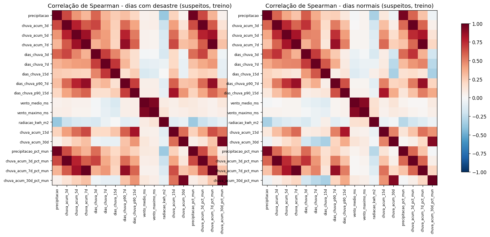

## 7. El Niño (ENSO)

| Fase | Meses | % de dias com desastre | Risco relativo vs Neutro |
| --- | --- | --- | --- |
| La Niña | 77 | 0,595% | 2,04× |
| Neutro | 142 | 0,292% | 1,00 |
| El Niño | 76 | 0,598% | 2,05× |

Teste qui-quadrado de independência entre fase e ocorrência de desastre: χ² = 1.363,7, gl = 2, p = 7 × 10⁻²⁹⁷. As duas fases extremas têm cerca do dobro de desastres: El Niño por excesso de chuva, La Niña por estiagem. O efeito se mantém dentro de cada período (treino, validação e teste).

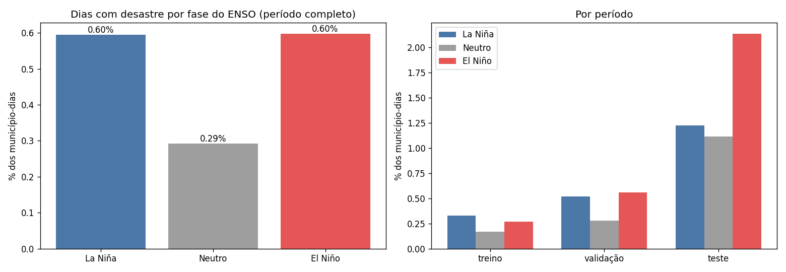

## 8. Climatologia (risco por mês)

Risco relativo médio de desastre por mês (1 = média do município), no treino:

| jan | fev | mar | abr | mai | jun | jul | ago | set | out | nov | dez |
| --- | --- | --- | --- | --- | --- | --- | --- | --- | --- | --- | --- |
| 1,48 | 1,13 | 0,78 | 0,75 | 0,72 | 0,89 | 0,69 | 0,79 | 0,95 | 0,78 | 0,92 | 2,12 |

O verão concentra os desastres. No teste, os meses classificados como de risco alto tiveram 6,1% de dias com desastre, contra 2,9% nos demais (1,8 vez; p < 0,001). Sozinha, essa climatologia tem AUC de 0,764, igual ao do modelo.

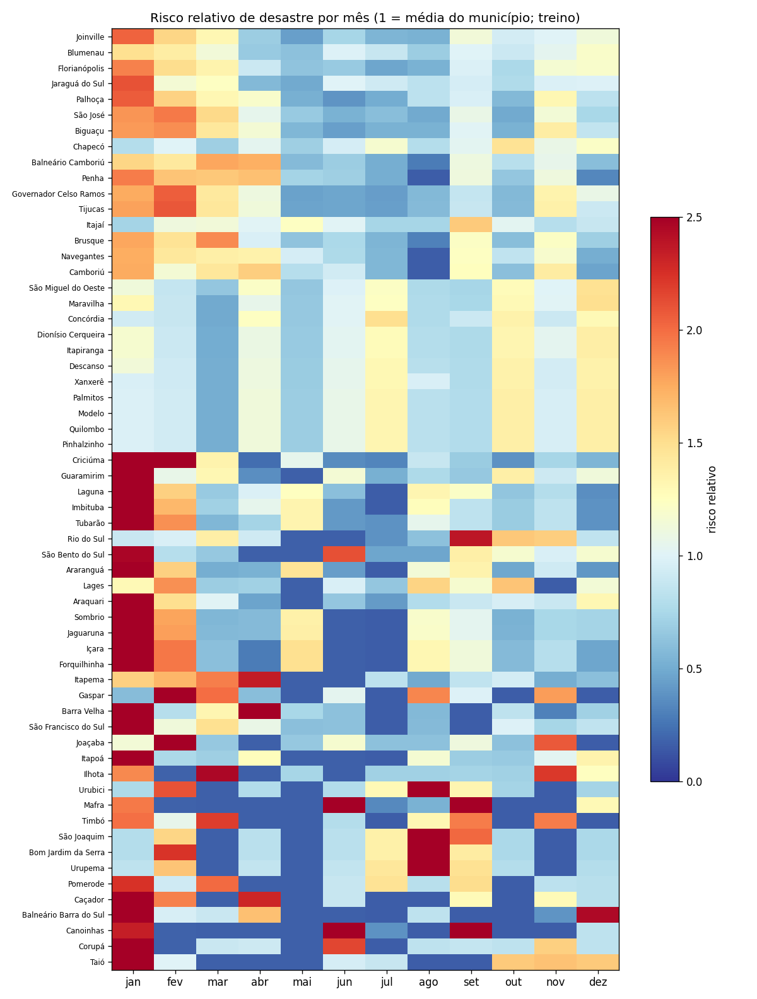

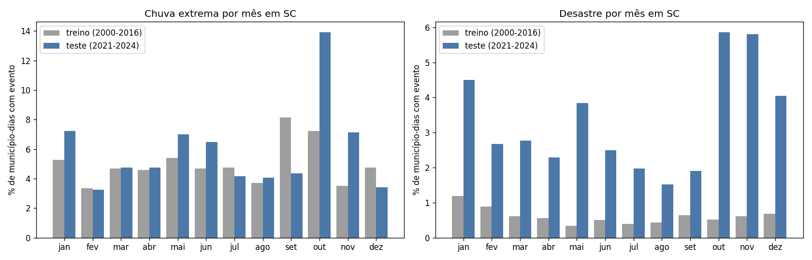

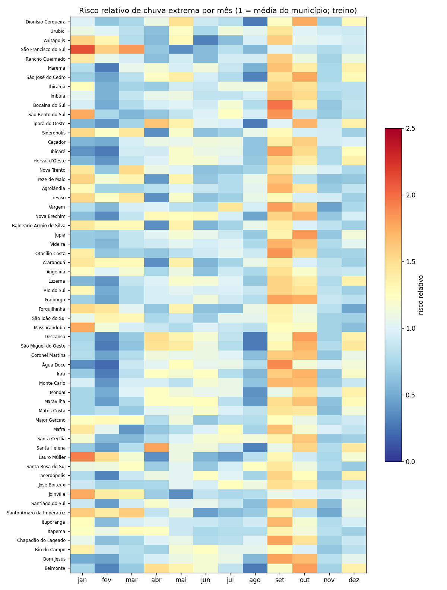

## 9. Limitações

1. **O modelo não supera a climatologia** (AUC de 0,747 contra 0,764). A capacidade de prever vem principalmente de onde e quando os desastres costumam ser registrados.
2. **59% dos desastres ocorrem com chuva normal**, provavelmente estiagens e registros não ligados à chuva do período.
3. **Os registros triplicaram a partir de 2021**, o que dificulta escolher limiares na validação (2017–2020).
4. **O limiar único** deixa municípios com muitos registros sempre em alerta e municípios com poucos quase nunca.
5. **A precisão é baixa** (9% no nível municipal), consequência de priorizar a detecção de um evento raro.

**Próximos passos:** separar os desastres hidrológicos das estiagens (código COBRADE da base S2iD) e incluir uma previsão meteorológica como entrada.

## Como atualizar esta análise

Os gráficos `00` a `06` e o gráfico do ENSO são gerados a cada execução do modelo. Os demais, ao rodar os scripts de `src/analises/`. Depois de uma nova execução, atualize os números deste arquivo com os da saída em `analises_anteriores/`.
