# Relatório: modelo LSTM para previsão de desastres em Santa Catarina

## Resumo

Construímos um modelo que olha para os últimos 30 dias de clima de cada município de Santa Catarina e estima a chance de um desastre ser registrado nos próximos 3 dias. No período de teste (2021 a 2024), o modelo **detectou 61% dos desastres** e **reconheceu 79% dos dias tranquilos**, com acurácia de 78%. Em vez de um simples "sim ou não", ele também classifica cada dia em quatro níveis de risco, que geram três comunicados: **observação, aviso e alerta**. Nos dias de risco mais alto, a chance real de desastre foi **5,6 vezes maior que a média**.

O modelo funciona, mas tem limites claros. A maior parte do acerto vem de saber **onde e em que época do ano** os desastres costumam acontecer, e não da chuva de cada dia. Isso acontece porque cerca de 6 em cada 10 desastres registrados aconteceram com chuva normal.

## Sumário

1. [Objetivo](#1-objetivo)
2. [Os dados](#2-os-dados)
3. [De onde vêm os eventos e os alertas](#3-de-onde-vêm-os-eventos-e-os-alertas)
4. [O que é o modelo](#4-o-que-é-o-modelo)
5. [Como o modelo funciona, passo a passo](#5-como-o-modelo-funciona-passo-a-passo)
6. [Como medimos se o modelo é bom](#6-como-medimos-se-o-modelo-é-bom)
7. [Resultados: acurácia, precisão e as outras medidas](#7-resultados-acurácia-precisão-e-as-outras-medidas)
8. [Como funcionam os alertas](#8-como-funcionam-os-alertas)
9. [Parâmetros que ajustamos e o que cada um trouxe](#9-parâmetros-que-ajustamos-e-o-que-cada-um-trouxe)
10. [Explicação dos gráficos](#10-explicação-dos-gráficos)
11. [O que mais descobrimos sobre os desastres](#11-o-que-mais-descobrimos-sobre-os-desastres)
12. [Limitações e próximos passos](#12-limitações-e-próximos-passos)

---

## 1. Objetivo

Criar um modelo preditivo de desastres para Santa Catarina que acerte **pelo menos metade dos dias com desastre e pelo menos metade dos dias sem desastre**. As previsões são feitas em dois níveis:

- **Municipal:** "qual a chance de este município ter um desastre registrado nos próximos 3 dias?"
- **Estadual:** "qual a chance de pelo menos 10 municípios serem atingidos nos próximos 3 dias?"

## 2. Os dados

| Item | Descrição |
| --- | --- |
| Período | 02/06/2000 a 31/12/2024 |
| Municípios | Os 293 de Santa Catarina |
| Tamanho | 2.630.847 linhas (uma por município por dia) |
| Clima | Chuva, vento e radiação solar (reanálise ERA5) |
| Desastres | Quantidade de desastres registrados por município e dia |
| El Niño | Índice ONI oficial da NOAA/CPC, baixado pelo próprio programa |

**Desastres são raros.** Só cerca de 3% dos dias de cada município têm desastre no período de teste. Isso torna a previsão difícil e, como veremos, muda a forma de medir se o modelo é bom.

## 3. De onde vêm os eventos e os alertas

Ao longo do relatório, duas palavras aparecem o tempo todo: **evento** e **alerta**. Elas têm origens diferentes:

| | De onde vem | O que é |
| --- | --- | --- |
| **Evento** | Da planilha de dados (coluna `Desastres`) | O que **realmente aconteceu**: houve ou não desastre registrado |
| **Alerta** | Do modelo | O que o modelo **previu**: se a chance de desastre é alta |

### O evento vem da coluna `Desastres`

A planilha tem uma coluna chamada `Desastres`, com a **quantidade de desastres registrados** em cada município em cada dia. É uma contagem: 0 quer dizer que não houve registro; 1, que houve 1 desastre; 3, que houve 3 desastres naquele município naquele dia.

Nos dados de 2000 a 2024, foram **15.761 desastres** registrados em **11.824 dias**:

| Desastres no mesmo dia e município | Quantidade de dias | % dos dias com registro |
| --- | --- | --- |
| 1 | 9.560 | 80,9% |
| 2 | 1.462 | 12,4% |
| 3 | 452 | 3,8% |
| 4 | 145 | 1,2% |
| 5 ou mais (máximo de 15) | 205 | 1,7% |

**A regra usada pelo modelo:** um dia com **pelo menos 1 desastre** é um dia **com evento**. Assim, a contagem vira um "sim ou não":

| Valor da coluna `Desastres` | Para o modelo |
| --- | --- |
| 0 | Sem evento |
| 1, 2, 3 ou mais | Com evento |

Isso quer dizer que, hoje, um dia com 1 desastre e um dia com 15 desastres contam do mesmo jeito: os dois são "com evento". A quantidade em si não entra na previsão. O parâmetro `LIMIAR_DESASTRES` permite mudar essa regra; por exemplo, com o valor 2, só dias com 2 ou mais desastres contariam como evento.

Como o modelo prevê os **próximos 3 dias**, a pergunta que ele responde é: *"vai haver pelo menos 1 desastre registrado neste município em algum dos próximos 3 dias?"*

Exemplo com linhas no formato da planilha:

| Município | Data | Chuva (mm) | Desastres | Evento? |
| --- | --- | --- | --- | --- |
| Blumenau | 10/01/2023 | 3 | 0 | não |
| Blumenau | 11/01/2023 | 85 | 2 | **sim** (2 desastres) |
| Blumenau | 12/01/2023 | 40 | 1 | **sim** (1 desastre) |

*(Linhas ilustrativas, só para mostrar o formato; não são valores reais da planilha.)*

### O modelo nunca "vê a resposta"

A coluna `Desastres` **não é usada como entrada** do modelo. O modelo recebe só o clima (chuva, vento, radiação), a localização, a época do ano e o El Niño. A coluna `Desastres` é usada apenas para:

- **ensinar (treino, 2000 a 2016):** mostrar ao modelo como estava o clima nos dias que antecederam os desastres;
- **conferir (teste, 2021 a 2024):** comparar o que o modelo previu com o que de fato aconteceu.

### O alerta é criado pelo modelo

O alerta **não existe na planilha**. A cada dia, o modelo calcula a chance de desastre nos próximos 3 dias e, se essa chance estiver entre as mais altas do último ano, emite um alerta. A seção 8 explica as regras em detalhe.

### Onde os dois se encontram

A avaliação do modelo é justamente a comparação entre os dois:

| | O modelo não alertou | O modelo alertou |
| --- | --- | --- |
| **A planilha mostra 0 desastres** | Acerto | Alarme falso |
| **A planilha mostra 1 ou mais desastres** | Desastre perdido | **Desastre detectado** |

Quando dizemos que o modelo **detectou 61% dos desastres**, isso significa: *dos dias em que a coluna `Desastres` mostrou pelo menos 1 registro, em 61% deles o modelo já tinha emitido alerta.*

### Um cuidado: "registrado" não é o mesmo que "aconteceu"

A coluna `Desastres` mostra o que foi **registrado oficialmente**. Isso tem três consequências:

- desastres pequenos podem não ter sido registrados;
- o registro pode ter sido feito alguns dias depois do evento, o que ajuda a explicar por que prever "nos próximos 3 dias" funcionou melhor que prever "amanhã";
- a coluna mistura tipos diferentes de desastre, como enchentes (causadas por excesso de chuva) e estiagens (causadas por falta de chuva).

### E o que é "chuva extrema"?

Em um dos testes (seção 9, etapa 10), também usamos o termo **chuva extrema**. Ela **não vem da coluna `Desastres`**: nós a calculamos a partir da coluna de chuva, como os 5% de períodos de 3 dias mais chuvosos de cada município. Esse teste foi descartado do modelo final, mas mostrou um resultado útil: quando a chuva extrema acontece, a chance de desastre registrado fica **6,7 vezes maior**.

## 4. O que é o modelo

### O que é uma LSTM

LSTM (do inglês *Long Short-Term Memory*, "memória de longo e curto prazo") é um tipo de rede neural feito para **sequências**, como uma série de dias. Ela lê os dias um por um, em ordem, e vai guardando uma espécie de "memória" do que aconteceu antes.

Isso é importante para desastres porque o risco depende do **acúmulo**. Um dia de chuva forte é mais perigoso se o solo já estiver encharcado por duas semanas de chuva. Um modelo que olhasse só o dia atual perderia essa informação; a LSTM consegue perceber o padrão ao longo dos 30 dias.

### Quais informações o modelo recebe

Organizamos as variáveis em grupos, de acordo com o papel de cada uma:

| Grupo | O que mede | Variáveis |
| --- | --- | --- |
| **Gatilho** | Chuva forte recente, que dispara o desastre | chuva do dia, chuva dos últimos 3 dias, dias de chuva forte na semana |
| **Umidade do solo** | Quanto o solo já está encharcado | índice de precipitação antecedente (API), chuva dos últimos 30 dias, dias de chuva em 15 dias |
| **Seca** | Falta de chuva (estiagens) | dias seguidos sem chuva, índice de seca (SPI) de 30 e 90 dias |
| **Atmosfera** | Céu encoberto e vento | radiação solar, vento máximo |
| **Contexto** | Características que não mudam dia a dia | localização, época do ano, fase do El Niño, risco histórico do município no mês |

Dois termos da tabela merecem explicação:

- **API (índice de precipitação antecedente):** uma forma de medir a umidade do solo. Ele soma a chuva dos dias anteriores, dando mais peso para os dias mais recentes. É como se o solo fosse "secando" aos poucos.
- **SPI (índice de precipitação padronizado):** compara a chuva dos últimos 30 ou 90 dias com o que é normal para aquele município naquela época. Valores negativos indicam seca; positivos, chuva acima do normal.

### Como as peças se encaixam

O modelo tem duas entradas:
1. **A sequência de 30 dias** dos grupos gatilho, umidade, seca e atmosfera, lida pela LSTM.
2. **O contexto** (local, época, El Niño e histórico), que passa por uma camada separada. Essa camada "avisa" a LSTM, antes de ela ler a sequência, de qual município e época se trata.

Essa separação segue uma ideia usada em modelos de hidrologia (a EA-LSTM, de Kratzert et al., 2019): o que muda todo dia é tratado de um jeito, e o que é fixo, de outro.

## 5. Como o modelo funciona, passo a passo

```
1. Pega os últimos 30 dias de clima do município
        ↓
2. A LSTM lê a sequência, sabendo de que município e época se trata
        ↓
3. Calcula a probabilidade de desastre nos próximos 3 dias (ex.: 4%)
        ↓
4. Compara essa probabilidade com as previsões do último ano
   (ex.: "está acima de 90% das previsões recentes")
        ↓
5. Define o nível de risco e o comunicado
   (baixo → observação | médio → aviso | alto ou muito alto → alerta)
```

### Como o modelo aprendeu

Para avaliar o modelo de forma honesta, dividimos os dados **por data**, sem misturar:

| Parte | Período | Para que serve |
| --- | --- | --- |
| Treino | 2000 a 2016 | O modelo aprende com esses anos |
| Validação | 2017 a 2020 | Escolhemos os ajustes e os limiares de alerta |
| Teste | 2021 a 2024 | Medimos o resultado final, em anos que o modelo nunca viu |

Separar por data é essencial: se o modelo treinasse com dias de 2023 e fosse testado em dias de 2022, ele estaria "vendo o futuro", e o resultado pareceria melhor do que é.

Como os desastres são raros, também usamos três técnicas para o modelo não "desistir" de prevê-los:
- **Amostragem:** no treino, usamos todos os dias com desastre e só 25% dos dias sem desastre.
- **Peso de classes:** errar um dia com desastre pesa mais que errar um dia tranquilo.
- **Focal loss:** uma forma de calcular o erro que dá mais atenção aos casos difíceis (Lin et al., 2017).

## 6. Como medimos se o modelo é bom

Toda previsão cai em uma de quatro situações. A tabela que as organiza se chama **matriz de confusão**:

| | O modelo disse "sem desastre" | O modelo disse "desastre" |
| --- | --- | --- |
| **Não houve desastre** | Acerto (verdadeiro negativo, VN) | Alarme falso (falso positivo, FP) |
| **Houve desastre** | Desastre perdido (falso negativo, FN) | Desastre detectado (verdadeiro positivo, VP) |

A partir dela calculamos as medidas:

| Medida | Pergunta que responde | Fórmula |
| --- | --- | --- |
| **Acurácia** | De todos os dias, quantos o modelo acertou? | (VN + VP) ÷ total |
| **Sensibilidade (recall)** | Dos desastres que aconteceram, quantos o modelo detectou? | VP ÷ (VP + FN) |
| **Especificidade** | Dos dias tranquilos, quantos o modelo reconheceu como tranquilos? | VN ÷ (VN + FP) |
| **Precisão** | Dos alertas emitidos, quantos se confirmaram? | VP ÷ (VP + FP) |
| **Acurácia balanceada** | Média entre sensibilidade e especificidade | (sensibilidade + especificidade) ÷ 2 |
| **AUC-ROC** | O modelo dá probabilidades maiores aos dias com desastre? (0,5 = acaso, 1 = perfeito) | área sob a curva ROC |

### Por que a acurácia sozinha engana

Como 97% dos dias não têm desastre, um "modelo" que **sempre** dissesse "sem desastre" teria 96,7% de acurácia, sem detectar nenhum desastre. Por isso, a acurácia precisa vir sempre junto da sensibilidade e da especificidade. Nossa meta foi justamente acertar pelo menos 50% de cada lado.

## 7. Resultados: acurácia, precisão e as outras medidas

### Resultado final (teste, 2021 a 2024)

| Nível | Acurácia | Sensibilidade | Especificidade | Acurácia balanceada | Precisão | AUC |
| --- | --- | --- | --- | --- | --- | --- |
| **Municipal** | **78,2%** | **61,1%** | **78,7%** | 69,9% | 9,0% | 0,747 |
| **Estadual** | 57,8% | 57,8% | 57,7% | 57,8% | 40,9% | 0,596 |

**A meta de 50% em cada classe foi atingida nos dois níveis.**

### Em palavras simples

- **Acurácia de 78%:** o modelo acertou 78 de cada 100 combinações de município e dia.
- **Sensibilidade de 61%:** de cada 10 desastres, o modelo avisou com antecedência sobre 6.
- **Especificidade de 79%:** de cada 10 dias tranquilos, o modelo reconheceu 8 como tranquilos.
- **Precisão de 9%:** de cada 100 alertas, cerca de 9 foram seguidos de desastre.

### Por que a precisão é baixa (e por que isso é esperado)

Uma precisão de 9% parece pouco, mas é preciso comparar com o acaso. Se o modelo emitisse alertas aleatoriamente, só 3,3% estariam certos (a frequência normal de desastres). O modelo acerta quase **3 vezes mais** que isso.

Além disso, existe uma troca inevitável: **para detectar mais desastres, é preciso emitir mais alertas, e mais alertas significam mais alarmes falsos.** Sistemas de alerta de eventos raros (enchentes, tempestades, exames de triagem médica) funcionam assim: preferem alguns alarmes falsos a deixar passar um desastre.

Nos dias de risco mais alto, a precisão melhora bastante: no nível "muito alto", **quase 1 em cada 5 dias teve desastre** (18,7%).

## 8. Como funcionam os alertas

### Passo 1: comparar com o último ano

Em vez de usar um valor fixo de probabilidade, o modelo compara a previsão de hoje com **todas as previsões do último ano** (de todos os municípios). Por exemplo: "a previsão de hoje para Blumenau está acima de 92% das previsões do último ano". Essa posição se chama **percentil**.

Por que fazer assim? Porque os registros de desastre ficaram 3 vezes mais frequentes a partir de 2021. Um limiar fixo, escolhido com dados de 2017 a 2020, ficaria desatualizado. Comparando sempre com o último ano, o alerta **se ajusta sozinho** às mudanças, usando só previsões passadas (nunca os resultados reais).

### Passo 2: níveis de risco e comunicados

| Posição da previsão no último ano | Nível de risco | Comunicado | O que significa |
| --- | --- | --- | --- |
| Metade de menor risco | Baixo | **Observação** | Acompanhar a situação |
| Entre 50% e 80% | Médio | **Aviso** | Atenção, as condições podem piorar |
| Entre 80% e 95% | Alto | **Alerta** | Risco elevado, preparar a resposta |
| Os 5% de maior risco | Muito alto | **Alerta** | Risco elevado, preparar a resposta |

### O que aconteceu de fato em cada nível (teste)

| Comunicado | Nível | Parte dos dias | Chance real de desastre | Comparado à média | Parte dos desastres |
| --- | --- | --- | --- | --- | --- |
| Observação | Baixo | 50,0% | 1,3% | 0,4 vez | 19,8% |
| Aviso | Médio | 29,8% | 2,4% | 0,7 vez | 21,7% |
| Alerta | Alto | 15,1% | 6,4% | 1,9 vez | 29,0% |
| Alerta | Muito alto | 5,2% | 18,7% | 5,6 vezes | 29,5% |

**Como ler:** quanto mais alto o nível, maior a chance real de desastre, que vai de 1,3% (observação) a 18,7% (muito alto), uma diferença de 14 vezes. Os dias de alerta são só 20% do total, mas concentram **58,5% de todos os desastres**.

### O alerta estadual

Para o estado, o modelo combina as probabilidades dos 293 municípios e calcula a chance de **pelo menos 10 municípios** serem atingidos no mesmo período. Usamos 10 porque, com um corte menor, quase todo dia teria desastre em algum lugar de SC e o alerta perderia o sentido. O alerta estadual também compara a previsão com o último ano, do mesmo jeito que o municipal.

## 9. Parâmetros que ajustamos e o que cada um trouxe

Chegamos ao modelo final depois de cerca de 20 execuções. A cada uma, mudamos poucos parâmetros e comparamos o resultado. A tabela mostra a trajetória:

| Etapa | O que mudamos | Resultado | Decisão |
| --- | --- | --- | --- |
| 1 | Modelo inicial com 60% dos municípios, previsão para o dia seguinte | O modelo "decorava" o treino logo na 1ª rodada (sobreajuste) | Ajustar o treino |
| 2 | Regularização: taxa de aprendizado menor (0,0005), mais dropout (0,4) e penalidade L2 | O treino ficou estável, mas o desempenho parou no mesmo teto | Manter; o limite não estava aqui |
| 3 | Prever os **próximos 3 dias** em vez do dia seguinte | Maior ganho: detecção subiu de 8% para 17% | Manter |
| 4 | Prever só o primeiro dia de cada evento | Piorou | Descartado |
| 5 | Usar os **293 municípios** | Precisão subiu de 24% para 32% | Manter |
| 6 | Alerta estadual com 10+ municípios | O alerta estadual deixou de disparar todo dia | Manter |
| 7 | Índice El Niño (ONI) como número | Piorou: o modelo usava o ONI para "decorar" períodos | Descartado nessa forma |
| 8 | El Niño como **etiqueta de fase** + risco histórico de cada município na fase | Melhor alerta estadual até então (AUC de 0,68) | Manter |
| 9 | Chuva acumulada de 15 e 30 dias e chuva em relação ao normal do município | Não mudou a capacidade de separar os dias | Mantidas, sem ganho |
| 10 | Prever chuva extrema em vez de desastre | O histórico não prevê a chuva futura (AUC de 0,63) | Descartado |
| 11 | Risco histórico do município no mês (climatologia) | Sem ganho: a rede já tinha essa informação | Mantida |
| 12 | Arquitetura separada, janela de 30 dias, variáveis de seca, focal loss | Ermo melhorou (AUC de 0,45 para 0,60); no geral, sem ganho | Mantida |
| 13 | Critério de limiar por equilíbrio e limiar próprio dos municípios menores | **Meta de 50% atingida** no municipal | Manter |
| 14 | Limiar adaptativo (comparação com o último ano) | **Meta atingida também no estadual**; municipal subiu para 61% e 79% | Versão final |

### Os parâmetros finais e para que servem

Todos ficam no topo do arquivo `src/modelo/modelo_lstm_desastres.py`, com comentários.

| Parâmetro | Valor final | O que faz | O que trouxe |
| --- | --- | --- | --- |
| `HORIZONTE_PREVISAO` | 3 | Quantos dias à frente o modelo prevê | Foi a mudança que mais melhorou a detecção, porque tolera o atraso entre a chuva e o registro |
| `PERCENTUAL_DADOS` | 100 | Porcentagem dos municípios usada | Mais exemplos de desastre para aprender; precisão maior |
| `TAMANHO_JANELA` | 30 | Quantos dias passados o modelo lê | Cobre o ciclo de umidade do solo |
| `TAXA_APRENDIZADO` | 0,0002 | Velocidade com que o modelo aprende | Valores menores evitaram o sobreajuste |
| `DROPOUT` | 0,5 | Desliga neurônios ao acaso no treino | Reduz a "decoreba" do treino |
| `REGULARIZACAO_L2` | 0,001 | Penaliza pesos muito grandes | Treino mais estável |
| `FUNCAO_PERDA` | focal | Como o erro é calculado | Mais atenção aos casos difíceis |
| `ARQUITETURA` | separada | Separa sequência diária e contexto | Organização mais clara; ganho pequeno |
| `USAR_ONI` e `CRIAR_FASE_ENSO` | sim | Usa a fase do El Niño | Melhorou o alerta estadual |
| `USAR_RISCO_HISTORICO_FASE` | sim | Risco do município em cada fase do El Niño | Associa a fase ao histórico de desastres |
| `MINIMO_MUNICIPIOS_EVENTO_ESTADUAL` | 10 | Quantos municípios formam um evento estadual | Deu sentido ao alerta estadual |
| `CRITERIO_LIMIAR_MUNICIPIO` e `_ESTADO` | equilíbrio | Como o limiar de alerta é escolhido | Equilibra sensibilidade e especificidade |
| `LIMIAR_MUNICIPIO_ADAPTATIVO` e `LIMIAR_ESTADO_ADAPTATIVO` | sim | Compara a previsão com o último ano | Permitiu atingir a meta nos dois níveis |
| `CORTES_NIVEIS_RISCO` | 50%, 80%, 95% | Separa os quatro níveis de risco | Define observação, aviso e alerta |

**A principal lição dos ajustes:** mexer na rede neural (tamanho, regularização, arquitetura) mudou pouco o resultado. O que mais fez diferença foi **definir bem a pergunta** (prever 3 dias, evento estadual com 10 municípios) e **escolher bem os limiares de alerta**.

## 10. Explicação dos gráficos

Todos os gráficos estão em `docs/analises/graficos/`. Os de número 00 a 06 são gerados automaticamente a cada execução do modelo.

### Gráfico 00: treinamento

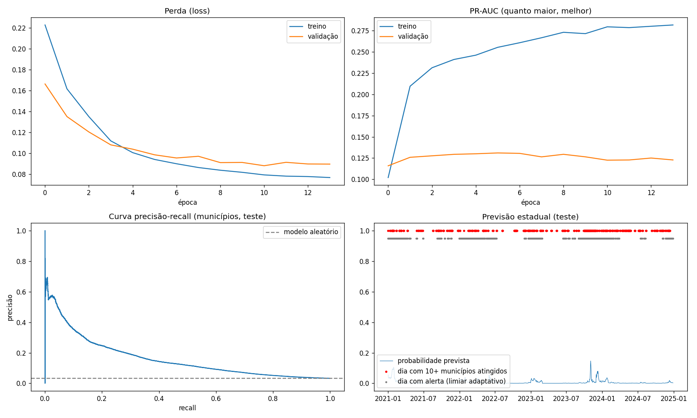

**O que mostra:** quatro painéis. Os dois de cima mostram como o erro (perda) e a qualidade (PR-AUC) evoluíram a cada rodada de treino, nos dados de treino e de validação. O de baixo, à esquerda, é a curva precisão-recall; à direita, a previsão estadual ao longo do teste.

**Como ler:** se a linha de treino melhora e a de validação não acompanha, o modelo está "decorando" o treino. É o que aparece aqui: a PR-AUC de treino sobe até 0,28, enquanto a de validação fica em torno de 0,13. O treino para sozinho quando a validação deixa de melhorar (aqui, depois de 14 rodadas).

### Gráfico 01: matrizes de confusão

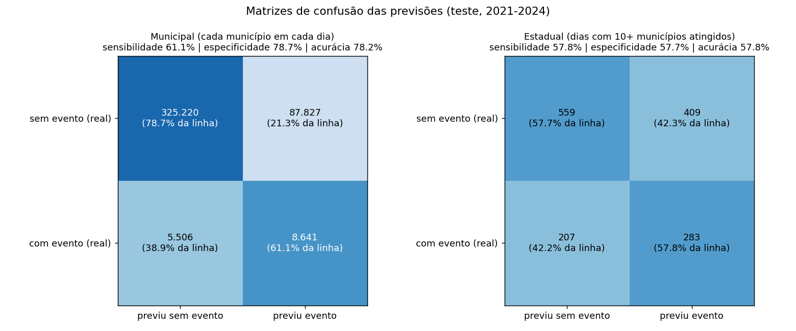

**O que mostra:** a matriz de confusão do nível municipal (à esquerda) e do estadual (à direita), com o número de casos e a porcentagem de cada linha.

**Como ler:** a diagonal (de cima à esquerda até embaixo à direita) são os acertos. No municipal, 78,7% dos dias tranquilos foram reconhecidos (canto superior esquerdo) e 61,1% dos desastres foram detectados (canto inferior direito). Quanto mais escura a cor, maior a porcentagem.

### Gráfico 02: níveis de risco e comunicados

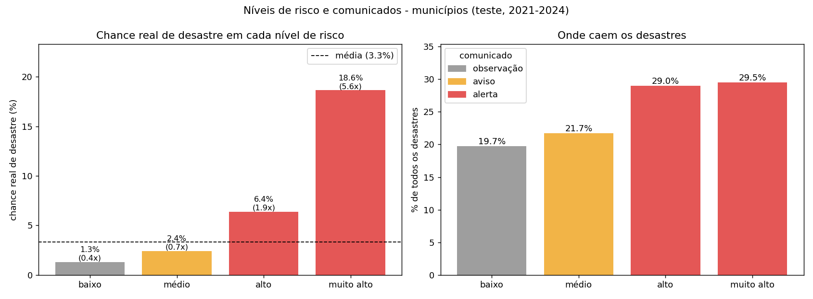

**O que mostra:** à esquerda, a chance real de desastre em cada nível; à direita, que parte de todos os desastres caiu em cada nível. As cores indicam o comunicado: cinza (observação), amarelo (aviso) e vermelho (alerta).

**Como ler:** a barra do "muito alto" chega a 18,7%, contra 1,3% do "baixo". A linha tracejada é a média (3,3%). Os dois níveis vermelhos juntos somam quase 60% dos desastres.

### Gráfico 03: curvas ROC e precisão-recall

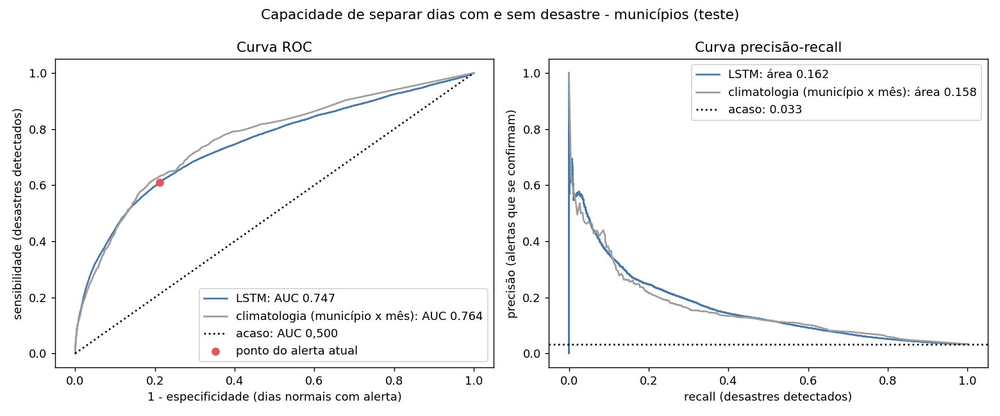

**O que mostra:** à esquerda, a curva ROC compara a detecção de desastres (eixo vertical) com os alarmes falsos (eixo horizontal) para todos os limiares possíveis. À direita, a curva precisão-recall mostra quantos alertas se confirmam para cada nível de detecção. A linha azul é o modelo; a cinza, a climatologia (só o risco histórico do município no mês). O ponto vermelho é o alerta que usamos.

**Como ler:** quanto mais a curva ROC se afasta da diagonal pontilhada (o acaso), melhor. As curvas do modelo e da climatologia quase se sobrepõem: o modelo é praticamente tão bom quanto saber onde e quando os desastres costumam ocorrer.

### Gráfico 04: previsão estadual ao longo do tempo

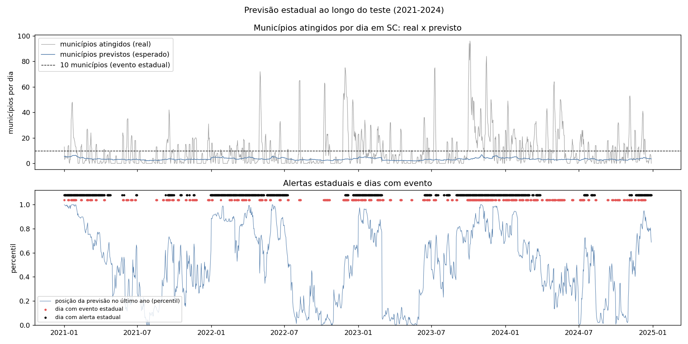

**O que mostra:** em cima, o número real de municípios atingidos por dia (cinza) e o número previsto (azul), com a linha dos 10 municípios. Embaixo, a posição da previsão no último ano, os dias com evento estadual (pontos vermelhos) e os dias com alerta (pontos pretos).

**Como ler:** os alertas (pretos) tendem a coincidir com os períodos de muitos eventos (vermelhos), como o fim de 2023. O modelo subestima a escala: prevê em média 3,4 municípios atingidos por dia, contra 9,7 na realidade.

### Gráfico 05: desempenho por município

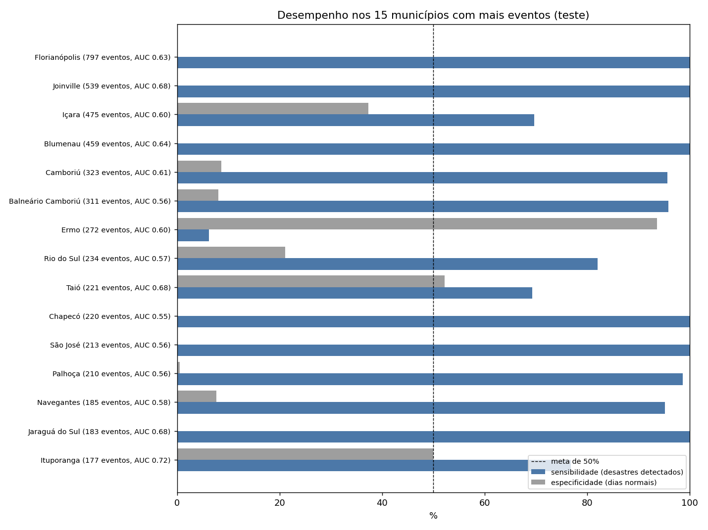

**O que mostra:** para os 15 municípios com mais desastres, a detecção (azul) e o reconhecimento dos dias tranquilos (cinza). A linha tracejada marca 50%.

**Como ler:** municípios com muitos registros, como Florianópolis e Joinville, têm detecção de 100%, mas reconhecimento de dias tranquilos perto de zero: ficam em alerta quase sempre. Municípios com poucos registros, como Ermo, quase nunca recebem alerta. É uma limitação de usar o mesmo limiar para todos.

### Gráfico 06: alertas por mês

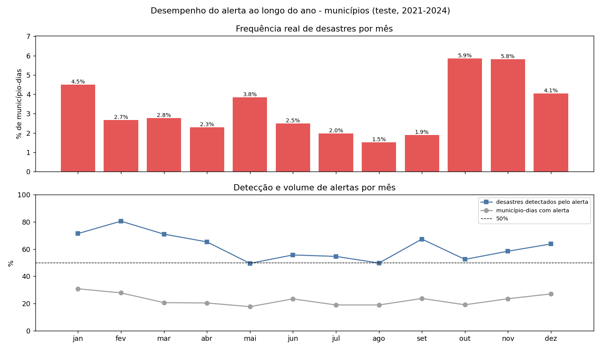

**O que mostra:** em cima, a frequência real de desastres em cada mês. Embaixo, a detecção de desastres (azul) e a porcentagem de dias com alerta (cinza).

**Como ler:** a detecção fica perto ou acima de 50% em todos os meses, com os melhores valores de janeiro a março (até 81% em fevereiro). Outubro e novembro tiveram mais desastres no teste, período que inclui o El Niño forte de 2023.

### Gráfico: desastres por fase do El Niño

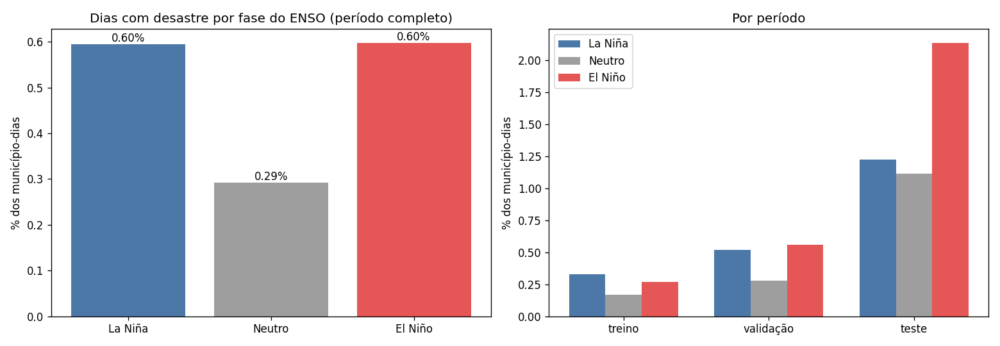

**O que mostra:** a porcentagem de dias com desastre em cada fase do El Niño (La Niña, Neutro e El Niño), no período completo e separada por período.

**Como ler:** as barras de La Niña (azul) e El Niño (vermelho) têm cerca do dobro da altura da fase Neutra (cinza). Ver a seção 11.

### Gráfico: taxa de desastre por faixa de valor

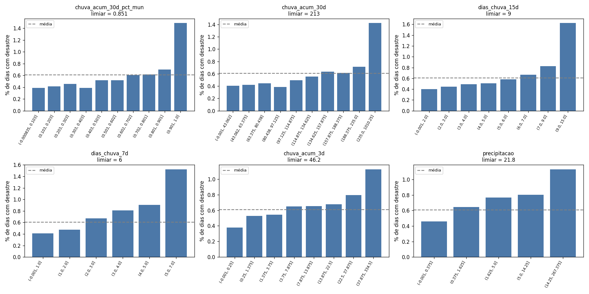

**O que mostra:** para as 6 variáveis mais importantes, a chance de desastre em cada faixa de valor (do menor para o maior), com a média como linha tracejada.

**Como ler:** as barras sobem da esquerda para a direita: quanto mais chuva acumulada, maior o risco. O título de cada painel indica o limiar a partir do qual o risco dobra.

### Gráfico: correlações entre variáveis

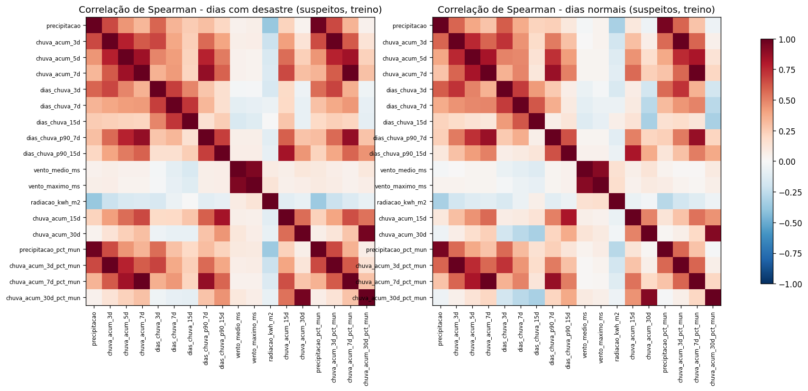

**O que mostra:** dois mapas de calor com a correlação entre todas as variáveis, nos dias com desastre (esquerda) e nos dias normais (direita). Vermelho indica que as variáveis sobem juntas; azul, que uma sobe quando a outra desce.

**Como ler:** a diferença entre os dois mapas mostra combinações típicas dos desastres. Nos dias normais, muitos dias de chuva e muito volume acumulado raramente acontecem juntos; nos dias com desastre, acontecem: é a chuva persistente e volumosa.

### Gráficos de climatologia

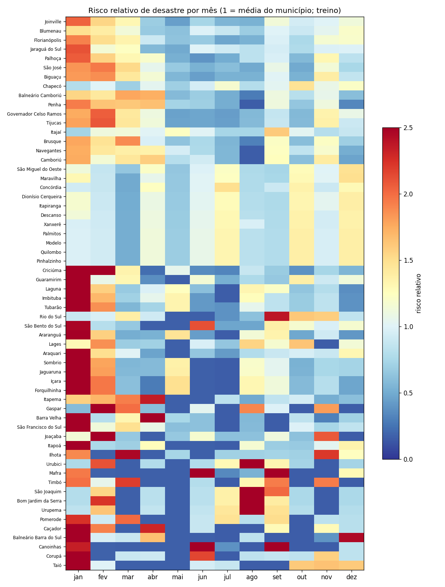

**O que mostra:** o risco de desastre de cada município (linhas) em cada mês (colunas), comparado com a média do próprio município. Vermelho é risco acima da média; azul, abaixo.

**Como ler:** é um "calendário de risco". A maioria dos municípios fica vermelha em dezembro, janeiro e fevereiro (verão).

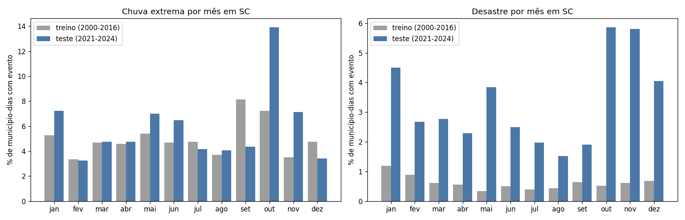

**O que mostra:** a frequência de chuva extrema (esquerda) e de desastres (direita) em cada mês, no treino (cinza) e no teste (azul).

**Como ler:** na chuva extrema, treino e teste são parecidos na maioria dos meses; a exceção é outubro do teste (14%), período do El Niño forte de 2023. Nos desastres, as barras do teste são de 3 a 10 vezes mais altas em todos os meses. Ou seja: **a chuva extrema não aumentou muito, mas os registros de desastre aumentaram bastante a partir de 2021**, o que reforça que a mudança está na forma de registrar.

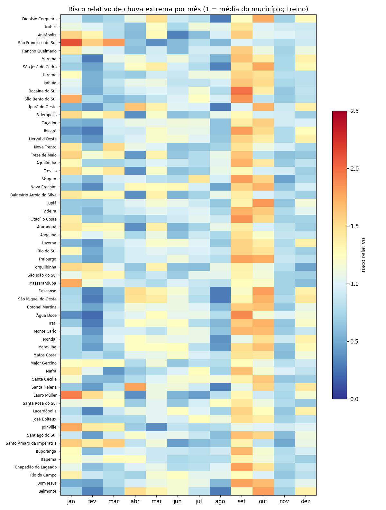

**O que mostra:** o mesmo calendário do mapa de desastres, mas para a chuva extrema.

**Como ler:** mostra em que meses cada município costuma ter chuva extrema. Comparar com o mapa de desastres ajuda a ver onde os desastres acompanham a chuva e onde não acompanham.

## 11. O que mais descobrimos sobre os desastres

Além do modelo, fizemos análises estatísticas para entender os dados. Elas ajudam a explicar os resultados.

### Qual variável pesa mais

Usamos uma **regressão logística**, que mede o efeito de cada variável descontando as outras, o município e a época do ano.

| Variável | Efeito (odds ratio por 1 desvio padrão) | Em palavras |
| --- | --- | --- |
| **Chuva dos últimos 30 dias** | **1,30** | Mais 30% de chance de desastre quando ela aumenta 1 desvio padrão. É a mais importante |
| Radiação solar | 0,83 | Menos sol (céu encoberto) significa mais risco |
| Vento máximo | 1,08 | Mais vento, um pouco mais de risco |
| Chuva do dia | 1,13 | O "gatilho" que, com o solo encharcado, dispara o evento |

Todas foram estatisticamente significativas (p < 0,001). Mas o **município** pesa muito mais que qualquer variável do clima (odds ratio de 8,6): onde o dia acontece explica mais que o clima daquele dia.

### A partir de quanta chuva o risco dobra

| Variável | Valor a partir do qual o risco dobra |
| --- | --- |
| Chuva dos últimos 30 dias | 213 mm |
| Dias de chuva em 15 dias | 9 dias |
| Chuva dos últimos 3 dias | 46 mm |
| Chuva do dia | 22 mm |
| Chuva dos últimos 7 dias | 80 mm |

A combinação mais perigosa foi: **um mês muito mais chuvoso que o normal, com chuva quase todos os dias e céu encoberto**, com 7 vezes a chance média de desastre.

### O achado mais importante

**Cerca de 59% dos desastres aconteceram com chuva igual à de dias normais.** Nesses casos, nenhuma variável de chuva poderia prever o desastre. Municípios do Oeste, como Chapecó (72% dos desastres sem chuva forte), sugerem que muitos desses registros são **estiagens**, desastres causados pela falta de chuva.

### El Niño e La Niña

| Fase | % de dias com desastre | Comparado à fase Neutra |
| --- | --- | --- |
| La Niña | 0,60% | 2 vezes |
| Neutro | 0,29% | 1 vez |
| El Niño | 0,60% | 2 vezes |

O **teste qui-quadrado** confirmou que a frequência de desastres depende da fase (p ≈ 10⁻²⁹⁷). As duas fases extremas dobram o risco, por motivos opostos: o **El Niño** traz excesso de chuva ao Sul do Brasil (enchentes); a **La Niña**, falta de chuva (estiagens).

### Época do ano

| jan | fev | mar | abr | mai | jun | jul | ago | set | out | nov | dez |
| --- | --- | --- | --- | --- | --- | --- | --- | --- | --- | --- | --- |
| 1,48 | 1,13 | 0,78 | 0,75 | 0,72 | 0,89 | 0,69 | 0,79 | 0,95 | 0,78 | 0,92 | 2,12 |

*(Risco de cada mês comparado à média do município: 2,12 em dezembro significa mais que o dobro do normal.)*

O verão concentra os desastres. Uma tabela simples com o risco de cada município em cada mês (a **climatologia**) separa os dias quase tão bem quanto a rede neural (AUC de 0,764, contra 0,747 do modelo).

## 12. Limitações e próximos passos

1. **O modelo não supera a climatologia.** A rede neural aprendeu, principalmente, onde e quando os desastres costumam ser registrados.
2. **6 em cada 10 desastres acontecem com chuva normal**, provavelmente estiagens e registros não ligados à chuva do período.
3. **Os registros triplicaram a partir de 2021**, o que dificulta escolher os limiares com dados mais antigos. O limiar adaptativo ajudou a contornar isso.
4. **O limiar é o mesmo para todos os municípios:** os que registram muitos desastres ficam quase sempre em alerta; os que registram poucos, quase nunca.
5. **A precisão é baixa (9%)**, consequência de priorizar a detecção de um evento raro.

**Próximos passos sugeridos:**
- **Separar os tipos de desastre.** A base S2iD da Defesa Civil classifica os registros (código COBRADE) em hidrológicos (enchentes, enxurradas, deslizamentos) e climatológicos (estiagem). Prever só os hidrológicos deve melhorar bastante o modelo.
- **Usar previsão do tempo como entrada.** Quando a chuva extrema realmente acontece, o risco de desastre fica 6,7 vezes maior. Com uma previsão meteorológica, o modelo poderia antecipar essa chuva.

## 13. Referências

As referências foram citadas a partir da literatura de referência da área; confira os dados completos antes de usar em trabalhos formais.

- Brodersen, K. H. et al. (2010). The balanced accuracy and its posterior distribution. *International Conference on Pattern Recognition*.
- Caine, N. (1980). The rainfall intensity-duration control of shallow landslides and debris flows. *Geografiska Annaler*.
- He, H.; Garcia, E. A. (2009). Learning from imbalanced data. *IEEE Transactions on Knowledge and Data Engineering*.
- Hochreiter, S.; Schmidhuber, J. (1997). Long short-term memory. *Neural Computation*.
- Kohler, M. A.; Linsley, R. K. (1951). Predicting the runoff from storm rainfall. *U.S. Weather Bureau*.
- Kratzert, F. et al. (2019). Towards learning universal, regional, and local hydrological behaviors via machine learning applied to large-sample datasets. *Hydrology and Earth System Sciences*.
- Lin, T.-Y. et al. (2017). Focal loss for dense object detection. *IEEE International Conference on Computer Vision*.
- McKee, T. B.; Doesken, N. J.; Kleist, J. (1993). The relationship of drought frequency and duration to time scales. *Conference on Applied Climatology*.
- Platt, J. (1999). Probabilistic outputs for support vector machines. *Advances in Large Margin Classifiers*.
- Youden, W. J. (1950). Index for rating diagnostic tests. *Cancer*.

---

*Números do desempenho: execução do modelo de 06/11/2026. Análises estatísticas complementares: execuções de 20/11/2026, com a mesma configuração. As saídas completas ficam na pasta `analises_anteriores/` (não enviada ao GitHub).*
